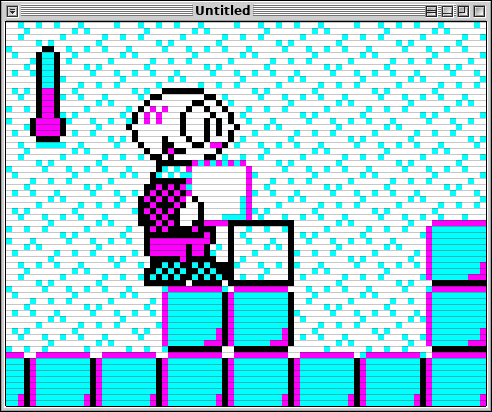
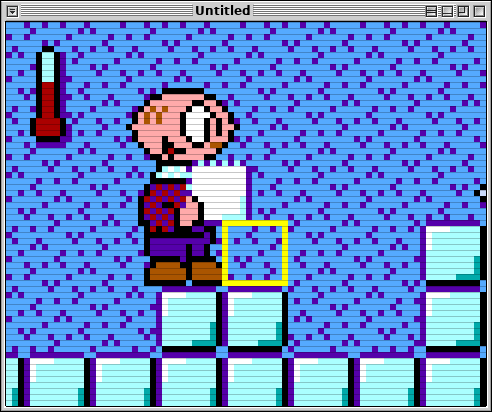
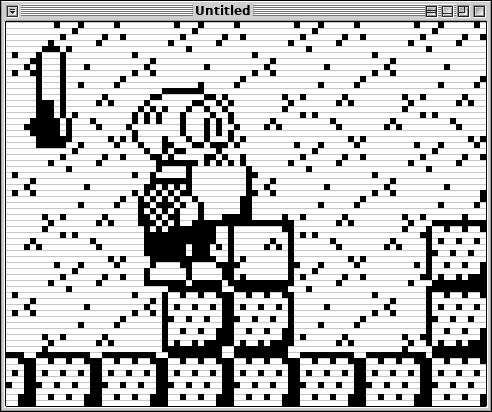

# Dodu

*An old-school puzzle game, written in QB64.*

**Dodu** is a small, level-based puzzle game about figuring out what to do with a handful of objects, obstacles, and rules. Its levels gradually introduce new mechanics, then ask the player to combine them in less obvious ways. The emphasis is on experimentation and planning rather than speed.

The project began in QuickBasic in **1994**. Its present incarnation revisits the original game with new levels, music, and display options, while retaining deliberately modest graphical and technical constraints.

<!-- Add a representative screenshot or short animated gameplay preview here. -->

## Gameplay

Guide Dodu through compact puzzle levels by exploring the environment and working out a sequence of actions. Depending on the level, you may need to move blocks, deal with snow and other terrain, or make use of items such as mittens, a tuque, and snowshoes. Later levels combine mechanics introduced earlier.

The game draws inspiration from classic puzzle games such as *Sokoban*, *Q*bert*, and *Lemmings*, without trying to reproduce any one of them.

<!-- Add two or three screenshots: an introductory level, a later level, and an item or block mechanic. -->
<!-- Add a link to a gameplay screencast. -->

## Design goals and constraints

Dodu is as much an exercise in designing *within* constraints as it is a return to an old project:

- **Tiny viewport.** The game was designed around an **80 × 64-pixel** viewport, inspired by the Gamebuino Meta.
- **Retro artwork.** Sprites are designed first for an EGA-style palette, then adapted by hand for more restrictive display modes.
- **QB64.** The game remains in the BASIC family in which it began, rather than being rewritten around a contemporary game engine.
- **MIDI music.** The soundtrack is composed and arranged as MIDI music, another deliberate nod to earlier PC gaming.

These constraints influence the artwork, interface, level design, and implementation. They are not intended to make the game difficult to play.

### One game, several graphical identities

The original Dodu was developed in the 1990s for
CGA's 640 × 200 two-color graphics mode. Its monochrome
appearance was therefore much closer to the present
Hercules rendering, although the pixel aspect ratio
was different.

The current version revisits the graphical constraints
of early PCs through several display modes. EGA serves
as the reference for new artwork, while CGA, Hercules,
and other modes use separately adapted assets.

Rather than relying on automatic color reduction, each
version is adjusted by hand to preserve readability
and visual character within its palette and resolution
constraints.

| CGA (4 colors) | EGA | Hercules |
|:---:|:---:|:---:|
|  |  |  |

The `Viewport` engine can also reproduce display
characteristics such as CRT scanlines, monochrome
green phosphor, and the pixel grid of a TI-83
calculator.

## Features

### Retro graphics and display emulation

Dodu supports artwork for **EGA, CGA, MCGA, and Hercules**-style modes, along with a **TI-83-inspired** presentation. The renderer can also simulate display characteristics such as scanlines and a visible LCD pixel grid. A green monochrome CGA presentation is produced from the CGA palette rather than from separately drawn sprites.

<!-- Add a small gallery showing the same scene in several modes. -->

### Optional stereoscopic display

Dodu can render **side-by-side images for the left and right eyes**. Its graphical layers are displaced by different amounts to create an impression of depth, without a 3D engine or head tracking.

A working experimental setup displays this output in a smartphone browser, using an MJPEG stream over the local network and an inexpensive phone-based VR headset. This is entirely optional: Dodu can be played on an ordinary screen.

<!-- Add a side-by-side stereo screenshot. -->

### Playing-card passwords

A four-playing-card password system lets players recover progress in the spirit of older console games.

<!-- Add a screenshot of the card-selection interface. -->

### Keyboard and joystick

The game supports both keyboard and joystick controls.

## Building and playing

Dodu is developed with **QB64 on Linux**. See [Technical notes](TECHNICAL.md) for implementation details and the experimental stereoscopic setup.

<!-- Before publication, supply and verify:
- QB64 edition/version and tested operating systems
- entry-point source file and exact compilation command
- how to launch the game and select a graphics mode
- keyboard/controller mappings
- MIDI playback dependencies, if any
-->

## About the project

What began as a QuickBasic game in 1994 has also become a way to revisit pixel art, animation, music composition, and old display technologies. The result is intended to be a game first, and a collection of technical curiosities second.

## License and credits

Copyright © 1994–2026 Sylvain Hallé.

<!-- Confirm the repository's license and whether code, artwork, and music share its terms. Link to the actual license file. -->
